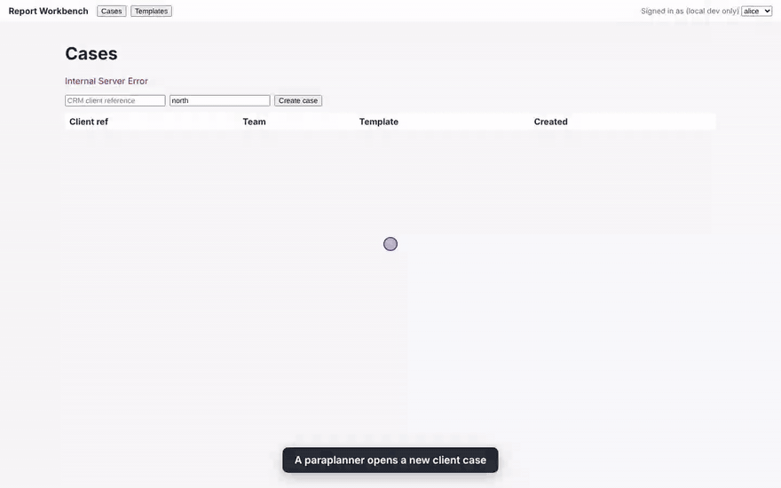
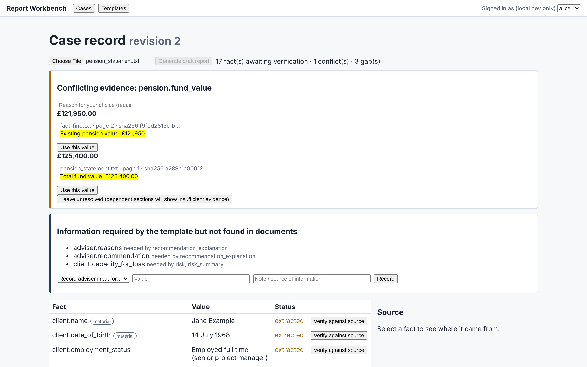
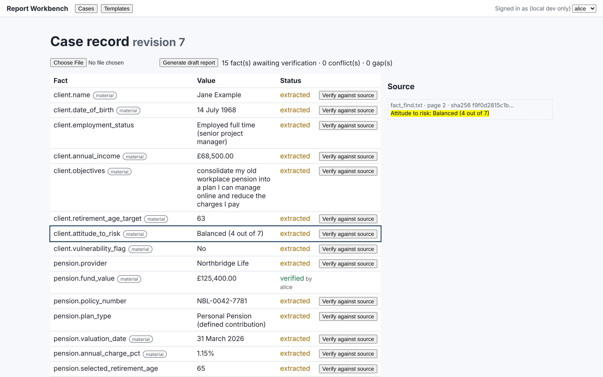
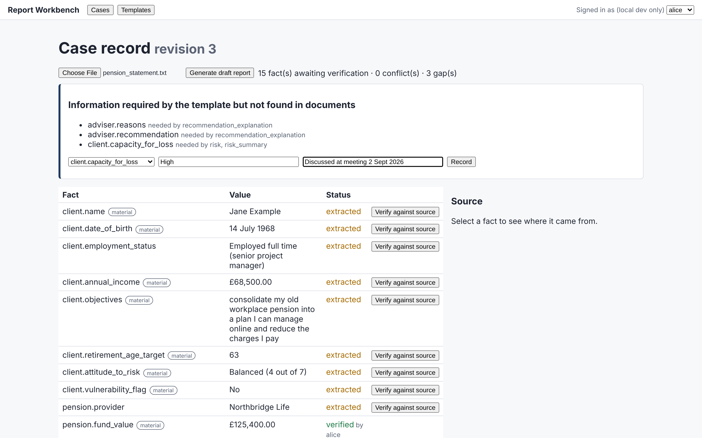
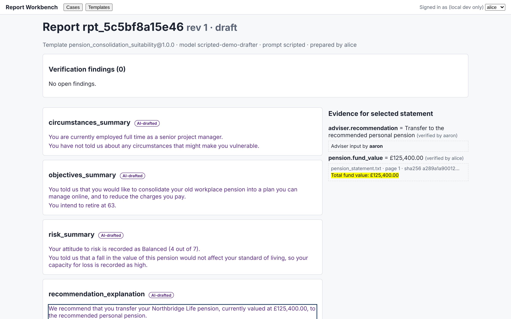
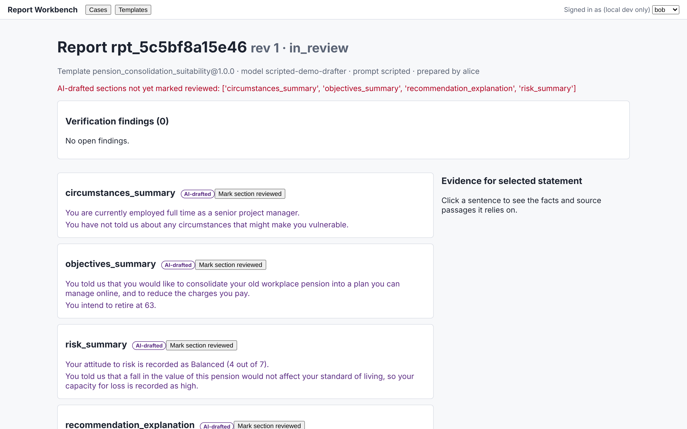
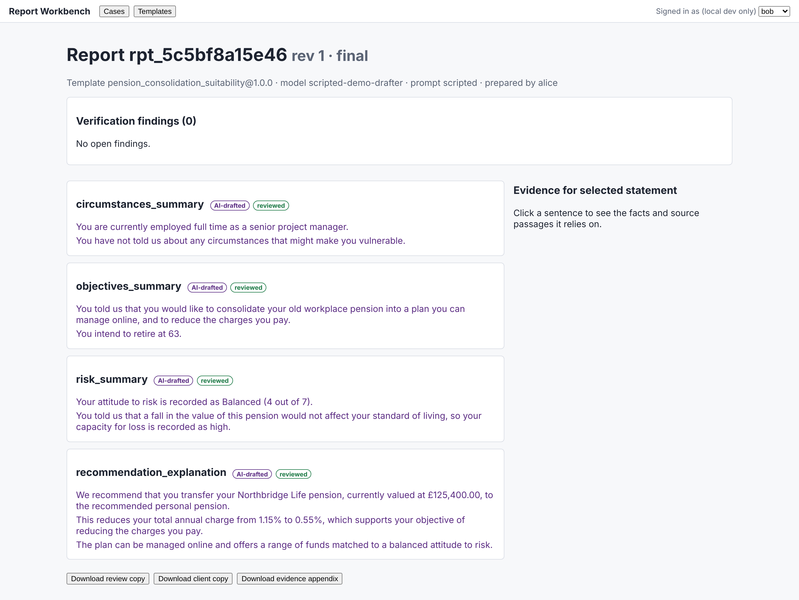
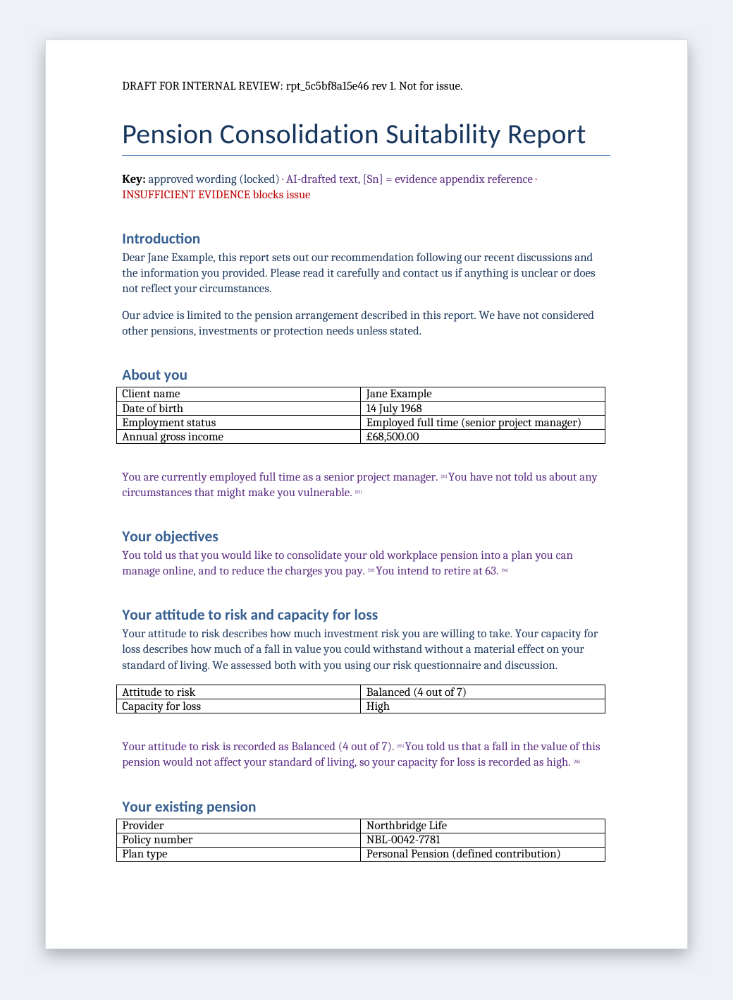
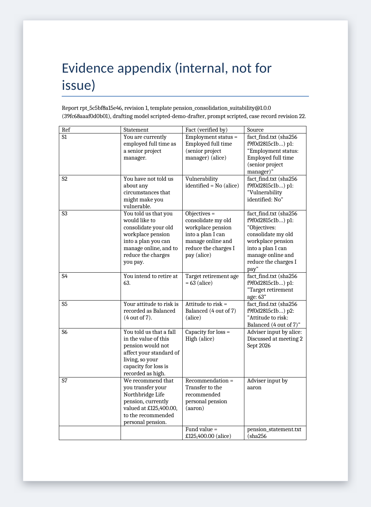

# AI Report Writing: proposal and reference implementation

This repository is a response to a request for proposals from a UK FCA-regulated financial services firm. The firm wants a secure, multi-user application that turns client documents into consistent, grounded, human-approved Word reports.

## See it in action



[Full walkthrough video (MP4, 1 min 40 s)](docs/media/walkthrough.mp4)

| | |
|---|---|
|  **Conflicting evidence.** Two documents disagree on the fund value. Each candidate shows its source passage, and a person must choose, with a reason. |  **Every fact is traceable.** Click a fact to see the document, page and passage it came from. |
|  **Gaps become tasks.** Information the template needs but no document provides is requested explicitly. Only an adviser can record the recommendation. |  **Grounded draft.** Findings are shown first. Each AI-drafted sentence links to the verified facts and source passages behind it. |
|  **Maker-checker.** A different person must review every AI-drafted section before approval is allowed. |  **Finalised.** The approved report is hashed and stored. Review, client and evidence-appendix copies are available. |
|  **Word review copy.** Approved wording (blue, locked) and AI text (purple, with `[Sn]` evidence references) are visibly distinct. |  **Evidence appendix.** An internal record linking each statement to its facts, who verified them, and the source passages. |

More: [client copy](docs/media/10-word-client-copy.png) · [template registry](docs/media/07-template-registry.png)

All data in the recording is synthetic. The drafted sentences come from the labelled `scripted-demo-drafter` (`APP_DEMO=1`), which is pre-written, evidence-faithful text standing in for Azure OpenAI. Everything else in the recording, including extraction, conflict detection, verification, the workflow and Word assembly, is the real code path. To regenerate the media, see `backend/scripts/record_media.mjs`.

| Path | What it is |
|---|---|
| [`docs/proposal.md`](docs/proposal.md) | **The proposal.** It answers RFP items 1–12 and lists the requirements and risks the brief does not mention. [`docs/proposal.docx`](docs/proposal.docx) is a Word export of it. |
| [`docs/architecture.md`](docs/architecture.md) | Deployment, pipeline, data model and state diagrams (Mermaid) |
| [`docs/adr/`](docs/adr/) | Architecture decision records |
| [`backend/`](backend/) | Python reference implementation of the pipeline and controls, with tests |
| [`frontend/`](frontend/) | React/TypeScript review workbench (evidence verification, findings-first report review) |
| [`infra/`](infra/) | Bicep landing zone for Azure UK South (private networking, CMK, regional Azure OpenAI, policy guardrails) |

The code shows that the controls described in the proposal are concrete and testable. It is not the finished product. Persistence is in-memory, and the drafting model in the demo is scripted, so everything runs offline without Azure.

## What the reference implementation demonstrates

- **Staged pipeline with typed contracts:** ingest → extract → evidence → draft → verify → assemble → review (`backend/app/pipeline/`).
- **Citable extraction:** every extracted value must cite a source span (document hash, page, bounding box) and pass a *quote check* against that span's text.
- **Case record:** duplicate values merge, conflicting values become `Conflict`s, and missing template requirements become `Gap`s. Every human decision is recorded and preserved when the record is rebuilt.
- **Closed-world drafting:** the model sees only verified facts allowed for each slot, never document text, so prompt-injection text in an uploaded document never reaches it. Missing facts produce a blocking `INSUFFICIENT_EVIDENCE` marker.
- **Deterministic verifier:** uncited statements, unknown, unverified or disallowed facts, figures and dates that don't match cited facts, prohibited wording, and an optional LLM entailment check.
- **Word output:** approved clauses sit in locked content controls, and AI text sits in tagged content controls with `[Sn]` references to an internal evidence appendix. The client copy is clean.
- **Workflow:** maker-checker (the preparer or an editor cannot approve), a per-section review requirement, blocking findings that cannot be dismissed, and approval invalidated by any later edit.
- **Template registry:** draft → review → approve (a different person, with the Compliance role) → publish. Published versions are immutable, and tampering is detected by content hash.
- **Audit:** an append-only, hash-chained log with no client content in event details. Tampering, deletion and reordering are all detectable.
- **Access control:** Entra ID roles plus case scoping by team or assignment. Platform admins have no default access to client content, and only Advisers can record the recommendation.

## Run it

```bash
cd backend
python -m venv .venv && . .venv/bin/activate
pip install -e ".[dev]"
pytest                      # 56 tests
python scripts/demo.py      # end-to-end walkthrough; writes outputs/demo_report_{review,client,evidence}.docx

# API + UI (local dev auth via X-Dev-User; users: alice, aaron, bob, carol, dan, erin, sam)
pip install uvicorn && APP_ENV=local uvicorn app.main:app --port 8000   # add APP_DEMO=1 for scripted demo drafts
cd ../frontend && npm install && npm run dev
```

The sample documents in `backend/samples/` are synthetic. They deliberately contain a value conflict, a missing fact and a prompt-injection line.

## Connecting real services

| Component | Local stand-in | Production implementation (in repo) |
|---|---|---|
| Layout/OCR | `PlainTextLayoutProvider`, `DocxLayoutProvider` | `AzureDocumentIntelligenceLayoutProvider` |
| Field extraction | `LabelMatchingExtractor` | `LLMExtractor` (structured outputs) |
| Drafting | `ScriptedDraftingModel` / `FactListingDraftingModel` | `LLMDraftingModel` + `AzureOpenAIClient` (managed identity, temperature 0, pinned deployment) |
| Entailment check | none | `LLMEntailmentChecker` |
| Persistence | in-memory `Store` | PostgreSQL ([`backend/db/schema.sql`](backend/db/schema.sql): RLS, append-only audit, immutable templates) + Blob Storage |
| Auth | `X-Dev-User` header | Entra ID JWT validation (`app/auth.py`) |
