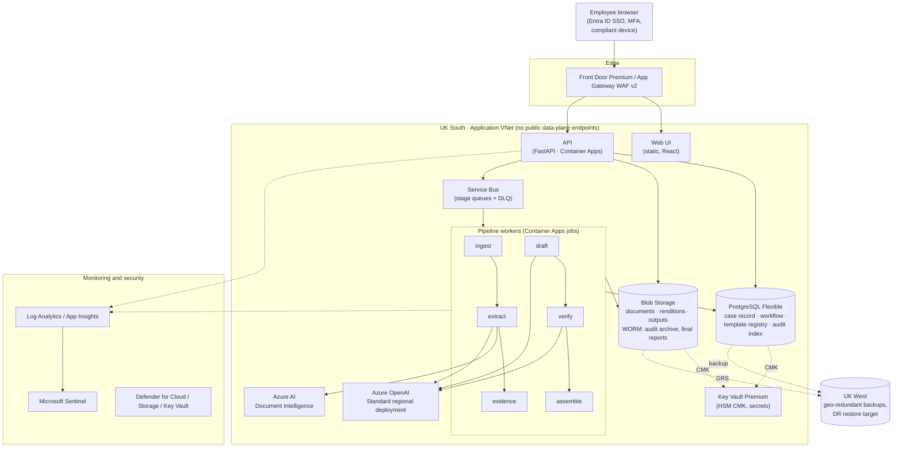
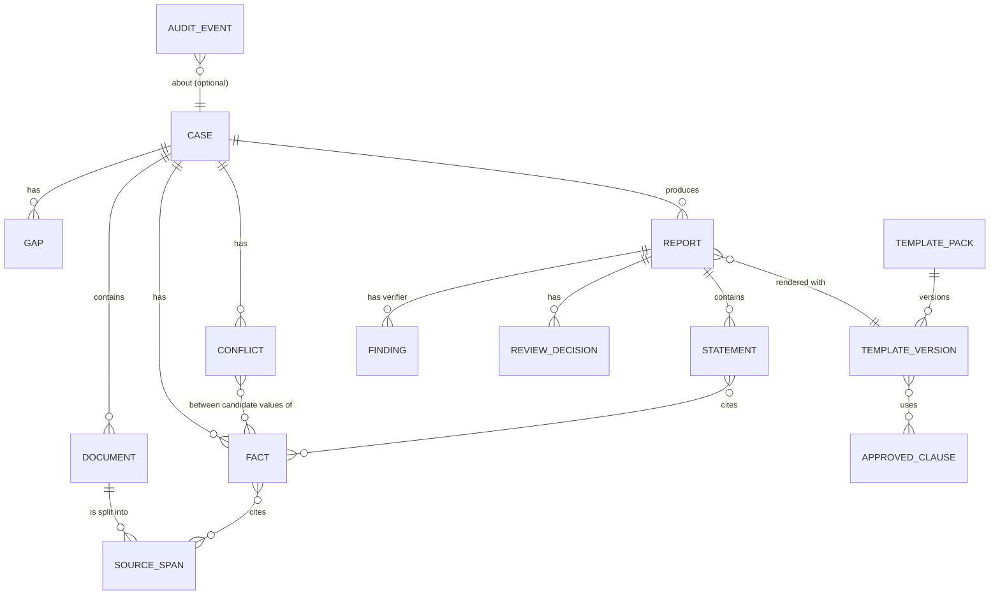
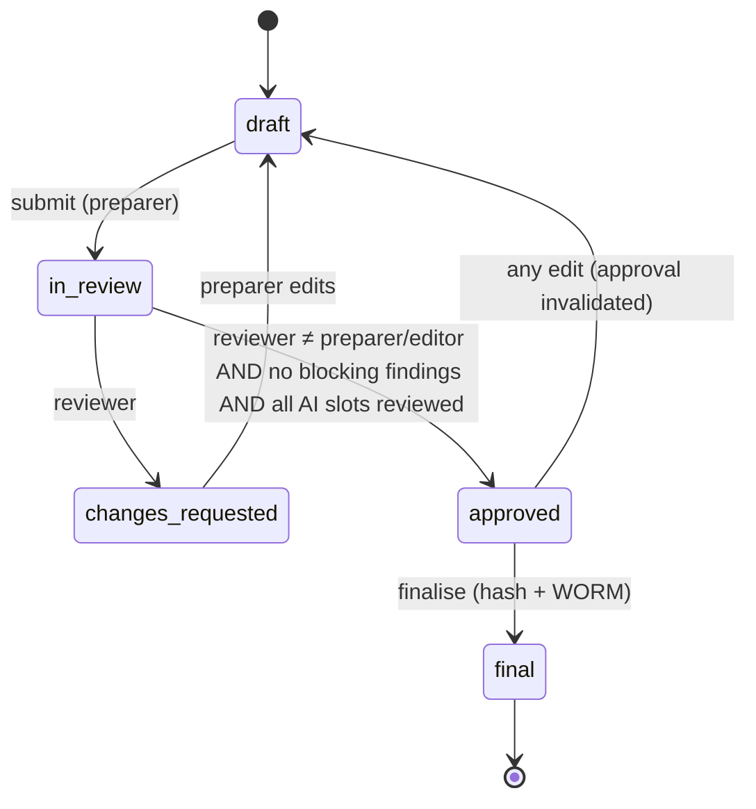

# Architecture

This document supports the proposal (`docs/proposal.md`). It describes the target Azure deployment, the processing pipeline and the core data model. The reference implementation in `backend/` follows the same stage boundaries and data contracts.

## 1. Deployment view (Azure, UK South)



Key settings, all enforced by Azure Policy where possible:

- Allowed locations: `uksouth` and `ukwest` only.
- Azure OpenAI deployment SKU: `Standard` (regional). `GlobalStandard`, `DataZoneStandard` and the other global or data-zone SKUs are denied.
- `publicNetworkAccess: Disabled` on Storage, PostgreSQL, Key Vault, Azure OpenAI, Document Intelligence and Service Bus. Each is reached through a private endpoint and private DNS zone.
- Managed identities only. Local auth (keys and SAS) is disabled where the service supports it (`disableLocalAuth`, `allowSharedKeyAccess: false`).
- Key Vault: purge protection on, RBAC authorisation, HSM-backed keys for CMK.
- Storage: blob versioning, soft delete, and container-level time-based immutability for `audit-archive` and `final-reports`.
- Diagnostic settings on every resource, sent to Log Analytics.

## 2. Processing pipeline

```mermaid
sequenceDiagram
  autonumber
  actor P as Preparer
  actor R as Reviewer
  participant API
  participant ING as Ingest
  participant EXT as Extract
  participant EVD as Evidence
  participant DRF as Draft
  participant VER as Verify
  participant ASM as Assemble
  participant AUD as Audit log

  P->>API: upload documents
  API->>ING: validate type/size, malware scan, SHA-256, rendition
  ING->>EXT: document ready
  EXT->>EXT: layout/OCR → SourceSpans (page, bbox)
  EXT->>EXT: classify → schema-constrained extraction (span ref per field)
  EXT->>EXT: deterministic validators + quote check
  EXT->>EVD: extracted fields
  EVD->>EVD: merge → Facts; detect Conflicts; compute Gaps vs template
  EVD-->>P: verification queue (low confidence, material, conflicts, gaps)
  P->>API: verify / correct facts, resolve conflicts (with reason)
  P->>API: request draft (template pack vX.Y)
  API->>DRF: per AI slot: allowed verified facts + slot instructions + examples
  DRF->>VER: Statements[] (each cites fact IDs)
  VER->>VER: citation, numeric, conflict, prohibited-phrase, (entailment) checks
  VER->>ASM: statements + findings
  ASM-->>P: DOCX (clauses locked, AI text in tagged content controls)
  P->>API: edit, submit for review
  R->>API: review findings first, check each slot, approve / request changes
  API->>API: maker-checker; block on open blocking findings
  API->>ASM: finalise → client DOCX/PDF + evidence appendix (hashed, WORM)
  Note over API,AUD: every step emits a hash-chained AuditEvent
```

## 3. Core data model



| Entity | Purpose | Key fields |
|---|---|---|
| `Document` | Uploaded source, never changed | `sha256`, `doc_type`, `classification_confirmed_by`, `rendition_uri` |
| `SourceSpan` | Smallest citable evidence unit | `document_id`, `page`, `bbox`, `text`, `ocr_confidence` |
| `Fact` | Typed case-record entry | `key` (e.g. `pension[0].transfer_value`), `value`, `value_type`, `source_span_ids`, `status` (`extracted`/`verified`/`corrected`/`rejected`), `verified_by` |
| `Conflict` | Same key, different values | `key`, `candidates`, `resolution`, `resolved_by`, `reason` |
| `Gap` | Required by template, not evidenced | `key`, `required_by_slot`, `resolution` |
| `TemplateVersion` | Immutable once published | `pack_id`, `semver`, `status`, `definition_hash`, `docx_hash`, `approved_by` |
| `Statement` | One AI-drafted sentence or short passage | `slot_id`, `text`, `fact_ids`, `insufficient_evidence` |
| `Finding` | Verifier output | `code`, `severity` (`blocking`/`warning`), `statement_id`, `message`, `dismissed_by`, `reason` |
| `ReviewDecision` | Maker-checker record | `reviewer`, `decision`, `report_revision`, `comment` |
| `AuditEvent` | Tamper-evident log | `seq`, `actor`, `action`, `object_ref`, `payload_hash`, `prev_hash`, `hash` |

## 4. Report state machine



## 5. Template pack structure

```
template_packs/<pack_id>/
  pack.yaml          # id, version, sections, conditions, merge fields, AI slots, required facts, rules
  clauses.yaml       # approved wording library entries used by this pack (id, version, text, approval)
  instructions.md    # house style and writing standards applied to every AI slot
  examples/<slot>.md # approved exemplar passages per slot
  report.docx        # optional Word layout (styles, headers, branding)
```

Each AI slot definition:

```yaml
- id: objectives_summary
  kind: ai
  instruction: Summarise the client's stated objectives in plain English...
  allowed_facts: [client.objectives, client.retirement_age_target, client.income_need]
  required_facts: [client.objectives]
  max_words: 120
```

## 6. Security boundaries

| Boundary | Control |
|---|---|
| Internet → app | WAF, TLS 1.2+, Entra ID auth on every API call, Conditional Access |
| App → data | Managed identity, private endpoints, RBAC on data plane |
| User → case | Role check plus case-scope check (team, assignment, restricted flag) in the API; optional PostgreSQL RLS |
| Document content → LLM instructions | Documents are only seen by the extraction prompt, whose output is a schema-validated, span-cited field set. Drafting never sees document text. |
| Admin → client data | Platform admins have no default content access. PIM elevation is time-boxed and audited. |
| Template change → production | Draft → compliance approval (different person) → regression suite → publish. Published versions are immutable. |
