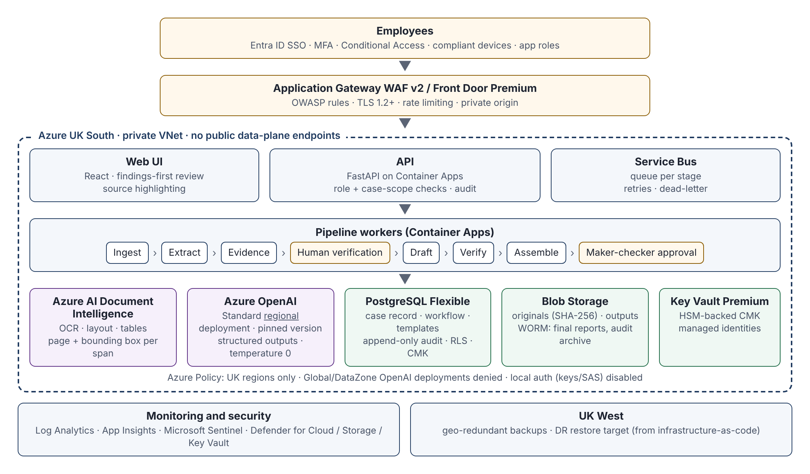

# Proposal: Secure AI Report-Writing Application

**Prepared by:** [APPLICANT NAME / TRADING NAME]
**Date:** [DATE]
**Status:** Indicative proposal for shortlisting. Not a fixed quotation.

---

## Executive summary

You need a shared business system that turns client documents into consistent, defensible, client-facing reports. A chatbot is the wrong shape for that job. This proposal treats the problem as a **regulated document workflow with an AI component**, not as an AI product with some workflow added later.

The design rests on five principles:

1. **Stages, not one prompt.** Ingestion, extraction, evidence organisation, drafting, verification, Word assembly and human approval are separate stages. Each stage has typed inputs and outputs that are stored, versioned and auditable. Each stage can be tested and re-run on its own.
2. **Closed-world generation.** The drafting model never sees raw client documents. It only sees the **verified case record** (facts that have been extracted, cited to a page and region of a source document, and confirmed or accepted by a person), plus the approved instructions for the section it is writing. If a fact is missing, the system writes an explicit *insufficient evidence* marker. That marker blocks finalisation. The model does not guess.
3. **The template, not the model, owns the document.** Report structure, fixed approved wording and every number, date and monetary amount come from the template and the case record, inserted deterministically. The model only writes bounded narrative passages, slot by slot, under slot-specific instructions. In the Word output, AI-drafted text is marked differently from approved wording.
4. **Every sentence is traceable.** Each generated statement carries the IDs of the facts it relies on. Each fact carries a reference to the exact source passage: document hash, page and bounding box. Reviewers can click from a sentence to the highlighted source.
5. **Governance is built in.** Maker-checker approval, a tamper-evident audit trail, versioned template packs with compliance sign-off, UK-only processing, customer-managed encryption keys and configurable retention are core features, not extras.

The recommended platform is **Microsoft Azure in UK South**, with **Azure OpenAI deployed as a Standard *regional* deployment** in UK South, **Azure AI Document Intelligence** for OCR and layout, **Entra ID** for identity, and private networking throughout. This fits a Microsoft-centric firm. It keeps processing in the UK, and it works with your existing identity, device and security controls.

I am a senior independent developer. I would lead design and build personally, with named associates for security architecture, user experience and independent testing. The indicative delivery is **about 30 weeks to a production pilot**. Indicative cost is **about £100k–£145k**, split into phases so that you can stop or re-scope after Discovery. Expected running costs are **about £3.5k–£7.5k per month** at the assumed volumes, including hosting for production and test environments, security monitoring, model usage and a support retainer (§12).

A reference implementation of the core pipeline accompanies this proposal: the extraction-to-evidence-to-draft-to-verification-to-Word stages, the maker-checker workflow, template pack versioning and the hash-chained audit log, with automated tests. It is not the product. It shows that the controls described here are concrete and testable.

---

## 1. Recommended technical architecture

### 1.1 Overview



Detailed diagrams and component descriptions are in `docs/architecture.md`.

### 1.2 Components and why each was chosen

| Concern | Choice | Reasoning |
|---|---|---|
| Identity | **Entra ID** (OIDC), app roles, security groups, PIM for privileged roles | Uses your existing joiner/mover/leaver process, MFA and Conditional Access. There are no separate passwords to manage. Privileged access is just-in-time and recorded. |
| Ingress | **Front Door Premium or Application Gateway WAF v2** | OWASP rule set, TLS termination and rate limiting. A private origin means the app is not directly reachable. |
| Compute | **Azure Container Apps** (API and workers) in a VNet-integrated environment | Managed scaling with workers that can scale to zero. Images are pinned and scanned. It is simpler to run than AKS for a system of this size. App Service is an equal alternative if your IT team prefers it. |
| Orchestration | **Azure Service Bus** queues between stages, dead-letter queues | Decouples long-running OCR and model calls from the UI. Failed jobs are retried and stay visible. Each stage can be re-run. |
| System of record | **Azure Database for PostgreSQL Flexible Server** (zone-redundant HA) | Relational integrity for cases, facts, citations, workflow state and template versions. Row-level security is available for case scoping. |
| Documents and outputs | **Blob Storage**: versioning, soft delete, CMK, separate container with **immutability (WORM)** policy for the audit archive and final reports | Source files are kept unchanged and identified by SHA-256 hash. Final records cannot be altered. |
| OCR and layout | **Azure AI Document Intelligence** (Layout and Read models; custom models where justified) | Handles PDF, scanned images, Word, tables, key-value pairs and handwriting. It returns page and bounding-box coordinates, which source citations need. |
| Language model | **Azure OpenAI** Standard regional deployment, UK South, pinned model version | Processing stays in the UK region, under Microsoft's enterprise data-processing terms. Prompts and outputs are not used for model training. Private endpoint. |
| Secrets and keys | **Key Vault Premium** (HSM-backed keys), managed identities everywhere | No connection strings in code or configuration. Customer-managed keys for storage and database. |
| Monitoring and security | **Log Analytics, Application Insights, Microsoft Sentinel, Defender for Cloud** | Central security monitoring that can feed your SOC. Alerting on unusual access, such as bulk downloads or out-of-hours exports. |
| Infrastructure | **Bicep** (or Terraform if preferred), deployed by pipeline into **your** Azure tenant | You own the environment, code and data from day one. This reduces lock-in and key-person risk. |

### 1.3 Why Azure and Azure OpenAI, and the alternatives

**Azure is a good default for you because:**

- Your firm already uses Microsoft. Entra ID, Intune device compliance, Purview and Defender integrate natively, so the application inherits controls you already run and audit.
- UK South provides in-region processing for both Document Intelligence and Azure OpenAI, when the right deployment type is used (see §8).
- Microsoft's Product Terms and Data Protection Addendum, financial services compliance documentation and audit and access rights for regulated customers support your SYSC 8 outsourcing due diligence.

**Caveats I would raise rather than hide:**

- **Model availability in UK South lags other regions.** The newest models sometimes reach UK South late, or arrive only as Global deployments, which can process data outside the UK. The design pins a model version that is available as a Standard regional deployment. The model layer sits behind an interface, so newer models can be adopted after re-evaluation, not on Microsoft's release schedule.
- **Capacity:** regional Standard deployments have quota limits. At the volumes you describe this is manageable. I would confirm quota during Discovery and request increases early.

**Credible alternative:** AWS with Amazon Bedrock in eu-west-2 (London), using Anthropic Claude or other models, plus Textract for OCR. It has comparable UK residency and security controls and strong models for long-document reasoning. I would recommend it only if your firm already runs on AWS. Otherwise, adding a second cloud and identity plane costs more in governance and integration than it gains. Model access in the design is abstracted (§4), so the choice of model provider is not permanent.

**Not recommended:** consumer or team subscriptions to ChatGPT, Copilot or similar products for this workflow. Microsoft 365 Copilot is useful for general productivity. It does not give you a controlled template pipeline, structured evidence, citation enforcement or maker-checker records.

---

## 2. Reliable extraction from varied financial documents

Financial documents vary: provider statements, fact-finds, pension valuations, transfer value statements, illustrations, payslips, P60s, bank statements, policy schedules, emails, letters of authority and scanned handwritten notes. Reliability comes from layering techniques and being explicit about uncertainty. No single model is reliable enough on its own.

**Step 1: Safe ingestion**
- File-type allow-list (PDF, DOCX, DOC, XLSX, MSG/EML, JPEG/PNG/TIFF), checked by file signature as well as extension, with size and page limits.
- Malware scanning (Defender for Storage) before any processing. Password-protected or corrupt files are rejected with a clear message to the user.
- SHA-256 hash recorded. The original is stored unchanged. A normalised rendition (PDF/A) is produced for consistent page referencing.

**Step 2: Layout and OCR**
- Document Intelligence Layout gives text, reading order, tables, selection marks and key-value pairs, each with **page number and bounding polygon**. These become **source spans**: the smallest unit of evidence the system can cite.
- OCR confidence is kept for each word and line. Low-confidence regions, typically handwriting and poor scans, are flagged automatically.

**Step 3: Document classification**
- Each document (or each section of a combined PDF) is classified against your taxonomy, for example *pension statement*, *fact-find*, *transfer value analysis* or *ID document*. Rules (provider headers, form identifiers) are tried first, and a model is used only for the remainder. Users confirm or correct the classification, because the classification decides which extraction schema is applied.

**Step 4: Schema-driven field extraction**
- Each document type has an **extraction schema** maintained as configuration, for example: `provider`, `policy_number`, `plan_type`, `valuation_date`, `fund_value`, `transfer_value`, `charges`, `guaranteed_benefits`, `safeguarded_benefits`, `death_benefits`, `selected_retirement_age`.
- The model is called with **structured outputs**, so the response must be valid JSON in that schema. **Every field must include the ID of the source span it came from**, or be returned as `not_found`. A value without a span is rejected by the system, not just discouraged in the prompt.
- Where your document volumes justify it, high-volume, stable layouts (a particular provider's annual statement, say) can use **Document Intelligence custom extraction models** trained on your labelled examples. These are deterministic and cheaper per page. The generative model handles the long tail.

**Step 5: Deterministic validation**
- Type and format checks: dates, currency, percentages, NI number and policy number patterns.
- Cross-checks: totals reconcile with their components, valuation dates are not in the future, and transfer value dates fall inside their guarantee period.
- **Quote check:** the extracted value must appear in, or be derivable from, the cited span text. For example, "£125,400.00" must match the span text "125,400". This catches the common failure where a model cites the right page but reports the wrong number.

**Step 6: Human verification queue**
- Fields below confidence thresholds, fields that fail validation, and every fact your rules mark as *material* (for example transfer values, guaranteed benefits and attitude-to-risk results) are put in front of the preparer. The extracted value is shown beside the highlighted source region. The preparer confirms, corrects or rejects the field, and each action is audited.
- Corrections are kept as labelled examples. They feed the evaluation set and, where appropriate, custom model training.

**Measuring reliability.** During Discovery we build a **golden set**: about 50–100 real, consented or pseudonymised documents across your common types, with hand-verified fields. Field-level precision and recall are reported for each document type, and that measurement sets the thresholds for automatic acceptance. I will not promise a single headline accuracy figure. Accuracy varies by document type and quality, and the system is designed so that low accuracy on a document type shows up in the verification queue instead of passing silently into reports.

---

## 3. Separating extraction, evidence organisation and report writing

The stages are separated physically (different workers and queues), logically (typed contracts between stages) and by permission (each stage can only read what it needs).

| Stage | Input | Output (persisted) | Can access |
|---|---|---|---|
| **Ingest** | Uploaded file | `Document` (hash, type, rendition) | Blob (write) |
| **Extract** | Document | `SourceSpan[]`, `ExtractedField[]` with span refs and confidence | Document Intelligence, LLM (extraction prompt only) |
| **Evidence** | Extracted fields from all case documents | **Case record**: `Fact[]` (with provenance), `Conflict[]`, `Gap[]` | Database only, no LLM by default |
| **Human verification** | Case record | Verified or corrected facts, resolved conflicts with reasons | UI |
| **Draft** | Verified facts permitted for each slot, plus the slot's instructions and examples | `Statement[]`, each citing fact IDs | LLM (drafting prompt). **No access to raw documents.** |
| **Verify** | Statements and case record | `Finding[]` (errors and warnings) | Deterministic checks, plus an optional LLM entailment check |
| **Assemble** | Template pack version, case record, approved statements | DOCX, with AI and fixed regions marked | Template registry |
| **Review and approve** | Report with findings | `ReviewDecision`, final record | UI (reviewer role) |

**The case record is the centre of the system.** It is a structured, versioned dataset for each client case. It is not a pile of text. A **fact** is a typed statement such as `pension[0].transfer_value = £125,400 as at 2026-03-31`. It lists its **sources** (one or more spans across documents), its **status** (`extracted`, `verified`, `corrected`, `rejected`), and who verified it and when.

The evidence stage:

- **merges duplicates**, for example the same fund value appearing on a statement and in a fact-find;
- **detects conflicts**: the same fact with different values in different sources, such as a fact-find giving retirement age 60 and a pension statement giving 65. Conflicts are shown to the preparer, who must choose a value or mark the item *unresolved* and give a reason;
- **identifies gaps**: facts the selected report template requires (for example *capacity for loss* or *state pension forecast*) that no document provides. Gaps become tasks: request the information from the client, record an adviser input, or confirm "not applicable" with a reason.

This separation has two further benefits. Each stage can be **evaluated on its own** (extraction accuracy, conflict detection, drafting faithfulness). And it **blunts prompt injection**: text inside a client document such as "ignore previous instructions" can at worst corrupt one extracted field, which still needs a citation and human verification. It never reaches the drafting model as an instruction.

---

## 4. Consistent outputs across employees and cases

Consistency is mostly a design property, not a prompting trick. The levers, in order of strength:

1. **Structure is fixed by the template pack.** Section order, headings, mandatory disclosures, tables and conditional sections (for example, *include the safeguarded benefits section only when `has_safeguarded_benefits` is true*) are defined in versioned configuration. The model cannot add or omit sections.
2. **Approved wording is inserted as is.** Regulated disclosures, risk warnings, standard explanations and the firm's descriptions of its services come from the **approved clause library**, versioned and signed off by compliance. The model never paraphrases them.
3. **Numbers are data, not prose.** Values, dates, percentages, charges and tables are merged from verified facts through deterministic fields with consistent formatting (for example £125,400.00, 31 March 2026). The model refers to merge fields. It does not type numbers.
4. **The model writes small, bounded slots.** Each AI slot (for example *client objectives summary* or *reasons the recommended option meets the stated objectives*) has its own instructions, allowed facts, target length, tone rules, prohibited phrases and **approved examples** chosen by your best advisers. Small, well-specified tasks vary much less than "write the report".
5. **Model configuration is pinned.** The model version is fixed, temperature is 0 (or the lowest value the model supports), the output is structured, and the prompt template is versioned. Every report records the exact model, prompt and template pack versions used.
6. **Evaluation gates changes.** A regression suite of golden cases is re-run before any change to a template, prompt, rule or model version is published. It measures citation coverage, unsupported-claim rate, rule violations, length and reviewer-edit distance against reference outputs. A change that makes results worse is not published.
7. **Reviewer feedback is measured.** The system records how much reviewers edit AI slots, and why reports are sent back. Slots with consistently high edit rates are flagged for an improved instruction or more examples.

---

## 5. Managing and versioning templates, approved wording and instructions

Everything a business user might reasonably want to change is **data held in a template registry**, never application code.

**A template pack contains:**
- **Word layout** (`.docx`): your house styles, headers, footers and branding, with named placeholders for sections, merge fields, clauses and AI slots. It is created and maintained in Word by your team.
- **Pack definition** (structured YAML or JSON, edited through the admin UI with validation): sections, conditions, required facts, merge fields and formats, AI slot definitions.
- **Approved clause library**: each clause has an ID, version, owner, approval record, effective-from and effective-to dates, and applicability conditions.
- **Instructions and writing standards**: the firm's style guide, tone, plain-English rules, prohibited phrases and Consumer Duty consumer-understanding expectations, at pack and slot level.
- **Examples**: approved exemplar passages for each slot.
- **Verification rules**: for example "a recommendation section must cite at least one *objective* fact and one *risk profile* fact", or "the words *guaranteed* and *risk-free* are forbidden except in the clause library".

**Lifecycle and control:**

```
draft ──► in_review ──► approved ──► published ──► retired
  ▲            │
  └── changes requested
```

- Only **Template Administrators** can edit drafts. Only **Compliance Approvers** can approve, and the same person cannot both author and approve a version.
- **Published versions cannot be changed.** A change creates a new version (semantic versioning: a wording correction is a minor version, a structural change is a major version). The system shows a field-level and text-level **diff** between versions for the approver.
- Each version is **validated before approval**: placeholders in the Word layout must match the definition, referenced clauses must exist and be approved, and the regression suite must pass.
- **Effective dating** lets you publish a version ahead of a regulatory change date and decide whether in-progress drafts move to the new version or stay on the old one.
- Every report stores the **exact pack version, clause versions, prompt versions and model version** used, so any historic report can be explained, and if necessary regenerated identically from the same inputs.
- Rollback means re-publishing the previous version, which is itself an audited event.

---

## 6. Keeping generated statements traceable to source material

Traceability runs down to sentence level:

```
Report ─► Section ─► Statement ─► Fact(s) ─► SourceSpan(s) ─► Document (SHA-256, page, bounding box)
```

- The drafting model returns **statements**, not free text. Each statement contains its text and the **list of fact IDs it relies on**. The output schema enforces this. A statement with no citations is rejected, unless the slot explicitly allows uncited connecting text, which the verifier then checks for factual content.
- Each fact carries its sources, verification status and verifier.
- **In the review UI**, clicking any AI-drafted sentence shows its facts and opens the source document at the highlighted region. Reviewers can see where a number came from without searching.
- **In the Word output**, AI-drafted passages sit inside **tagged content controls** with a distinct style. The tags hold statement IDs, so reviewers working in Word can see what is AI-drafted and what is approved wording. Approved clauses are in **locked** content controls. At finalisation the reviewer-facing markings are removed from the client copy, and the marked version is kept as part of the internal record.
- An **evidence appendix**, for internal use and never sent to the client, is produced with each final report. It lists every statement, its facts and their sources, and forms part of the file record for compliance and complaints handling.
- Source documents are identified by hash, and retention rules keep sources for at least as long as the reports that cite them. A citation therefore cannot point to a document that has changed or been deleted while the report is still retained.

---

## 7. Controlling hallucinations, unsupported claims and conflicting information

Several overlapping controls are used, because none is enough alone:

| Risk | Control |
|---|---|
| Model invents facts | **Closed world**: drafting sees only verified facts permitted for that slot, never raw documents and never "general knowledge" about the client. |
| Model states facts without support | **Mandatory citations** enforced by the schema. The verifier rejects statements that cite no facts, cite facts that do not exist, or cite facts that are unverified or rejected. |
| Model gets a number wrong | Numbers go through merge fields. The verifier also checks that **every number, date and percentage in AI text matches a value in a cited fact**. |
| Model fills a gap with a plausible guess | Instructions require an explicit **`[INSUFFICIENT EVIDENCE: …]` marker** when the allowed facts do not support the required content. Markers are highlighted in red, listed as blocking findings and **prevent finalisation** until a person resolves them. |
| Conflicting sources | Conflicts are detected in the evidence stage and **must be resolved before drafting**, by choosing the value with a reason or marking it unresolved, in which case dependent slots receive the insufficient-evidence marker. The model never picks between conflicting values. |
| Text is unsupported but plausible | Optional **entailment check**: a second model call, with a different prompt and role, judges whether each statement is supported by its cited facts. Unsupported statements become findings for the reviewer. It is a safety net, not a guarantee. |
| Promotional or prohibited language | Rule-based checks for prohibited phrases (for example *guaranteed*, *risk-free*, *you will*), unbalanced benefit statements without risk warnings, and missing mandatory disclosures. These come from the pack's verification rules, which compliance controls. |
| Recommendation drift | The AI **does not decide the recommendation**. The adviser's recommendation and their reasons are captured as **adviser-input facts**. The model writes them up in the firm's style and links them to client circumstances. Suitability judgement stays with the qualified adviser. |
| Reviewer misses something | The review UI shows **findings first**, requires each AI slot to be marked as reviewed, and shows source evidence beside the text. This reduces automation bias (see Risks). |

The goal is not "zero hallucinations", which no honest supplier can promise. The goal is that **any unsupported content is either blocked or clearly shown to a qualified human before the report can be finalised**, and that this is demonstrable from the audit trail.

---

## 8. UK data residency, encryption, access control, retention and deletion

### 8.1 Data residency

- All resources are deployed in **UK South**. Backups replicate to **UK West**. Azure Policy **denies resource creation outside UK regions** in the subscription.
- **Azure OpenAI is deployed as a Standard regional deployment** in UK South. Global and DataZone deployment types are **excluded by policy**, because they can process prompts outside the UK. Document Intelligence is likewise deployed in UK South.
- **Abuse monitoring:** by default, Azure OpenAI can keep flagged prompts and outputs for a limited period for abuse review. As an approved enterprise customer handling sensitive regulated data, you can **apply to Microsoft for modified abuse monitoring**, so that prompts and completions are not stored for human review. I recommend applying during Discovery, because approval takes time.
- Microsoft does not use customer prompts or outputs to train its foundation models. That position, and Microsoft's sub-processors, should be recorded in your DPIA and outsourcing file.
- Telemetry (Application Insights, Log Analytics) is in-region and **contains no client personal data**. Logs carry IDs, not content.

### 8.2 Encryption

- **In transit:** TLS 1.2 or later everywhere. HSTS on the web front end. Private endpoints keep service traffic off the public internet.
- **At rest:** Azure Storage and PostgreSQL encrypted with **customer-managed keys** held in Key Vault Premium (HSM-backed), with key rotation and purge protection. Key access is audited.
- **Secrets:** none in code or pipelines. Workloads authenticate with **managed identities**.
- **Endpoints:** downloads of client documents and reports can be limited to compliant, Intune-managed devices through Conditional Access, and optionally labelled with Microsoft Purview sensitivity labels.

### 8.3 Access control

- **Authentication:** Entra ID SSO with MFA. Conditional Access for location, device compliance and session lifetime.
- **Role-based access** (Entra app roles, mapped from security groups):

| Role | Typical capabilities |
|---|---|
| Preparer / Paraplanner | Create cases, upload documents, verify facts, generate drafts, edit drafts |
| Adviser | As preparer for own cases; record recommendation and reasons |
| Reviewer / Checker | Review, request changes, approve reports **they did not prepare** |
| Compliance | Read-only across cases for file checking; approve template packs; MI |
| Template Administrator | Edit template pack drafts (cannot approve them) |
| Platform Administrator | Operate the platform; **no default access to client content** |
| Auditor | Read-only access to audit logs and evidence packs |

- **Case-level access:** on top of roles, case access is limited by team or office, case assignment and explicit sharing, enforced in the API and, optionally, by PostgreSQL row-level security. Access to restricted cases (staff, high-profile or vulnerable clients) needs additional permission.
- **Privileged Identity Management** for every administrative Azure role: time-limited, approved and recorded. Break-glass accounts are monitored.
- Quarterly **access recertification** reports, produced from the system.

### 8.4 Retention and deletion

- **The retention schedule is configuration**, set with your compliance and DPO team, by record type: source documents, case record, drafts, final reports, evidence appendix, audit log. FCA record-keeping periods vary with the type of business. For example, COBS sets different minimum periods for MiFID business, for life and pension business, and for pension transfers, conversions and opt-outs, which must be kept indefinitely. Your compliance function should confirm the schedule, and the system enforces it.
- **Drafts and intermediate data**, such as rejected generations and superseded extractions, have short retention by default, so the firm is not keeping personal data it does not need.
- **Legal hold** stops deletion for complaints, litigation, FOS referrals or regulatory requests.
- **Deletion** is a workflow: it is scheduled, reviewed where required, and carried out across database, blob storage and search indices, with a **deletion certificate** (what, when, under which rule) kept in the audit log. Backups age out within a documented period.
- **Data subject rights:** the case record structure makes subject access requests practical, by exporting all data for a data subject. Erasure requests are checked against retention obligations before action.
- **Non-production environments use synthetic or properly anonymised data only.** No live client data is used in development or test.

---

## 9. Auditability, human approval and regulatory oversight

### 9.1 Audit trail

- **Append-only, tamper-evident audit log.** Each event records who, what, when, where (IP and device), the case and object, and the before and after state or a hash of it. Events are **hash-chained**, each including the hash of the previous one, so any change or deletion can be detected. They are copied continuously to an **immutable (WORM) storage container**.
- **Events covered:** sign-in, case view, document upload, download and deletion, extraction runs, fact verification and correction, conflict resolution, generation runs (model, prompt version, template version, and hashes of the inputs and outputs), every edit, findings raised and dismissed with reasons, review decisions, finalisation, export, template changes and approvals, permission changes, retention actions.
- **Generation records:** for each model call the system stores the exact prompt, response, model version and parameters, under the retention schedule. This lets you show, years later, exactly what the AI produced and what people changed.

### 9.2 Human approval

- Mandatory **maker-checker**: a report cannot be approved by anyone who prepared or edited it. This is enforced by the system and recorded.
- **Approval is blocked** while there are open blocking findings: insufficient-evidence markers, failed verification checks, unresolved conflicts, or AI slots not marked as reviewed.
- **An edit after approval invalidates the approval** and sends the report back for review.
- **Finalisation** produces the client DOCX (and PDF), with both hashed and stored in the immutable container. The approval record states who approved, when and against which version.
- Configurable **sampling**: for example, a percentage of finalised reports, or all reports for certain advice types, can be routed to compliance for a second-line check before or after issue.

### 9.3 Oversight and MI

- Dashboards for heads of advice and compliance: volumes, turnaround, findings by type, reviewer edit rates for each AI slot, reasons for sending reports back, insufficient-evidence frequency, and model and template versions in use.
- This supports **Consumer Duty** outcome monitoring (consumer understanding, consistency of communications) and gives **SM&CR** senior managers evidence of oversight of the tool.
- **Evidence packs** for a case or a time period can be exported for file reviews, complaints, FOS cases or FCA requests.
- **Model governance:** an inventory entry for each model use (purpose, model, version, owner, evaluation results, known limitations), with re-evaluation before any model change. This follows recognised model risk management practice, including the PRA's SS1/23 principles as a reference standard, in proportion to your firm.

---

## 10. Relevant experience

> **[APPLICANT TO COMPLETE]**: replace this section with your own experience. Suggested structure below. Specific, verifiable detail is far more persuasive here than general claims.

**Profile**
- [Years of experience; core disciplines such as Python and cloud engineering, Azure, secure application design, document processing, LLM application development.]
- [Certifications, for example Microsoft Certified: Azure Solutions Architect Expert / Azure Security Engineer / Azure AI Engineer; CISSP or equivalent where held.]
- [Security vetting or clearance, if any.]

**Case study 1: [Regulated-sector secure application]**
- *Client and sector:* [anonymised if necessary, e.g. "UK wealth manager, ~200 staff"]
- *Problem:* [...]
- *Regulatory and security constraints:* [e.g. UK GDPR DPIA, FCA outsourcing, ISO 27001 controls, pen test findings remediated]
- *What I built:* [architecture, your role, technologies]
- *Outcome:* [measurable results]

**Case study 2: [Document extraction or AI / LLM system]**
- [As above, emphasising grounded generation, evaluation, human-in-the-loop review.]

**Case study 3 (optional): [Multi-user business application with workflow and audit]**

**Associates** (engaged as needed, named at contract stage):
- *Security architect / penetration tester:* [name, credentials (e.g. CREST/CHECK)]. Threat modelling, architecture review, independent pen test.
- *UX designer:* [name]. Review and verification interfaces, accessibility.
- *QA / test engineer:* [name]. Evaluation datasets, regression and UAT support.

**References:** [two client references available on request].

---

## 11. Indicative delivery plan, timescale, team and cost

### 11.1 Approach

Delivery is phased and incremental, with a working, demonstrable system at the end of each phase, deployed into **your** Azure tenant from the first phase. Discovery ends with a firm scope and a fixed-price option for the later phases.

### 11.2 Team

| Role | Who | Commitment |
|---|---|---|
| Lead architect and developer | [Applicant] | Full time through build |
| Security architect / pen tester | Associate | ~10–15 days across threat model, design review, pen test |
| UX designer | Associate | ~8–12 days, mainly phases 3–5 |
| QA / evaluation engineer | Associate | ~8–10 days, phases 4–7 |
| **Your product owner** | Firm | ~1 day a week; decisions, priorities, acceptance |
| **Your compliance / DPO lead** | Firm | ~0.5 day a week; DPIA, retention, template sign-off |
| **Subject-matter experts** (paraplanner, adviser) | Firm | Workshops, golden-set labelling, UAT |
| **Your IT / cloud team** | Firm | Tenant, subscription, network, Entra integration, SOC onboarding |

### 11.3 Phases

| # | Phase | Weeks | Key outputs |
|---|---|---|---|
| 0 | **Discovery and design** | 3 | Current workflow mapping; report types in scope (recommend **one report type** for the first release); document inventory; golden-set plan; threat model; DPIA input; data flow map; retention schedule draft; Azure OpenAI quota and modified abuse monitoring applications; confirmed architecture, backlog and fixed-price quote |
| 1 | **Foundations** | 4 | Landing zone (Bicep), private networking, Entra integration and roles, CI/CD, audit log, case and document model, upload with malware scanning |
| 2 | **Ingestion and extraction** | 5 | Document Intelligence integration, classification, extraction schemas for in-scope document types, validators, extraction evaluation against the golden set |
| 3 | **Evidence and case record** | 4 | Fact merging, conflict and gap detection, verification UI with source highlighting |
| 4 | **Drafting, verification and Word assembly** | 5 | Template pack v1, slot drafting, citation enforcement, verifier, DOCX assembly with marked AI and fixed regions, regression suite |
| 5 | **Review workflow and template administration** | 4 | Maker-checker, findings-first review UI, template registry with lifecycle and diffs, MI dashboards |
| 6 | **Hardening and assurance** | 4 | Independent pen test and remediation, performance and DR test, accessibility review, runbooks, UAT |
| 7 | **Pilot** | 4 | Live use by one team, with heightened review sampling; measurement against baseline; go/no-go for wider roll-out. Lead developer part time (about 2–3 days a week) on support and fixes |

**Total: about 29–33 weeks** from contract to the end of the pilot. The duration depends largely on how quickly your firm can provide sample documents, approvals and IT access. These are the usual causes of delay, so Discovery sets named owners and dates for each dependency.

### 11.4 Indicative cost

| Item | Effort | Indicative cost |
|---|---|---|
| Lead architect and developer | ~140–150 days at £550–700/day | £77,000–£105,000 |
| Associates (security, UX, QA) | ~26–37 days | £15,000–£25,000 |
| Independent penetration test (CREST-accredited provider) | Fixed | £8,000–£15,000 |
| **Total (excluding VAT and Azure consumption)** | | **≈ £100,000–£145,000** |

- **Discovery alone** (phase 0) can be contracted separately for about **£9k–£12k**. It produces an architecture, a backlog and a fixed-price offer for phases 1–7, and you are under no obligation to continue.
- Azure consumption during the build (development and test environments) is estimated at £500–£1,500 per month and is billed to your subscription.
- The range reflects scope variables that Discovery will settle: the number of report types and document types, integration with your CRM or back-office system, and whether e-signature or client portal delivery is in scope.

---

## 12. Expected ongoing costs

The assumptions are stated so you can rescale them. Azure prices change, so I will refresh these figures from the current UK South price list at contract stage.

**Assumptions:** 200 reports a month; an average of 15 documents and about 150 pages per case; 2 draft generations per report; 1 production and 1 non-production environment.

| Cost line | Basis | Indicative monthly |
|---|---|---|
| **Platform hosting**, production | WAF ingress, Container Apps, PostgreSQL Flexible (zone-redundant HA), storage, private endpoints, Key Vault, Service Bus, backup | £1,400–£2,200 |
| **Security monitoring** | Log Analytics ingestion, Defender plans, Sentinel (if not already licensed by you) | £200–£600 |
| **Non-production environment** | Smaller SKUs, no HA, scaled down out of hours | £300–£600 |
| **Document Intelligence** | ~30,000 pages a month on the layout model | £250–£400 |
| **Azure OpenAI usage** | See unit-cost model below | £200–£800 |
| **Support and maintenance retainer** | 2–4 days a month: patching, dependency and security updates, model-version upgrades with re-evaluation, template support, minor enhancements, monitoring triage | £1,100–£2,800 |
| **Total** | | **≈ £3,500–£7,400 / month** |

**Model usage, per report** (illustrative): extraction about 200k input and 30k output tokens; drafting about 80k input and 12k output tokens per generation (×2); verification about 60k input and 6k output tokens. That is roughly 0.4–0.5M tokens per report. At current rates for capable mid-tier models on a regional deployment, this works out to about **£1–£4 per report**. Cost controls include per-case and per-user quotas, alerts on unusual spend, caching of extraction results (documents are processed once, not at every regeneration) and the option to use a smaller model for classification.

**Other recurring items:**
- An annual penetration test (about £6k–£12k) and an annual review of the DPIA, threat model and access.
- Model lifecycle: Azure retires model versions on a published schedule, typically giving 12 months or more for generally available models. Each upgrade needs a re-evaluation cycle (about 3–5 days), which is covered by the retainer if planned in advance.
- Response times under the support agreement: [e.g. P1 within 2 business hours, P2 within the next business day], set out in a support agreement suited to your operational resilience requirements.

---

## Important requirements and risks not in the brief

These are items I would raise at shortlisting, because they affect scope, cost or regulatory position:

1. **DPIA and lawful basis.** Processing at this scale needs a Data Protection Impact Assessment before go-live. Client documents often contain **special category data**, such as health information in protection, later-life or vulnerability contexts, and **third-party data** about spouses, dependants and employers. Both need a documented lawful basis and, for special category data, an Article 9 condition. Privacy notices may need updating to describe AI-assisted report preparation. The Data (Use and Access) Act 2025 changed parts of the UK framework on automated decision-making. This system is designed so that no decision with legal or similar effect is automated, and that should be recorded in the DPIA. I will support your DPO with technical input.
2. **Who is responsible for advice.** The tool must not become the source of the advice. The recommendation and its justification must remain the adviser's. The system records adviser inputs as distinct facts, and the AI writes them up. This should be stated in policy, training and the system itself.
3. **Automation bias.** Reviewers who see fluent, well-formatted text tend to approve it. Controls: findings shown first, per-slot review confirmation, MI on review time and edit rates, periodic "seeded error" tests, and compliance sampling. Plan for training, not just software.
4. **Consumer Duty and vulnerable customers.** Reports are a key consumer-understanding output. Templates should be tested for comprehension. Vulnerability flags in the case record should be able to trigger template variants (for example plainer language, larger fonts, accessible formats) and extra review.
5. **Prompt injection through uploaded documents.** Documents from clients and third parties are untrusted input. The staged design limits the damage (see §3), and this should be explicitly in the threat model and pen test scope.
6. **Outsourcing and operational resilience.** Using Microsoft and an external developer counts as outsourcing under SYSC 8, and potentially as part of an important business service under the operational resilience rules (SYSC 15A). You will need due diligence, contractual audit and access rights, an exit plan and data portability. The design supports this: the system runs in your tenant, the code is in your repository, the infrastructure is code, and all data is exportable in open formats.
7. **Key-person risk with a solo lead.** This is a fair concern with a single-developer supplier. Mitigations: everything built and owned in your tenant and repository from day one; architecture decision records and runbooks; automated tests and infrastructure-as-code, so another competent engineer can take over; a named associate who can provide cover; and an optional handover programme for your IT team or a second supplier.
8. **Model availability and change.** Model versions will be retired during the system's life. New versions behave differently even with the same prompts. A **model change procedure** (evaluate on the golden set, compliance sign-off, staged rollout) is needed and is built into the plan.
9. **Record-keeping versus erasure.** Regulatory retention can override erasure requests. The retention schedule and erasure procedure need agreement with compliance before go-live.
10. **Integration.** Most efficiency gains depend on integration: pulling client data from your CRM or back-office platform, filing final reports back, and e-signature. These are not in the brief and should be scoped in Discovery, even if they come in a second release.
11. **Document quality and coverage.** Handwritten fact-finds, photographed documents and unusual provider formats will lower extraction accuracy. The golden set should include your *worst* typical documents, not your best.
12. **Measuring success.** Agree baseline metrics before the build: current time to produce a report, file-check failure rate, rework rate. Without a baseline, the pilot cannot show value.
13. **Disaster recovery.** Agree recovery time and recovery point objectives (RTO/RPO) for the service. The proposed design targets RPO ≤ 15 minutes (point-in-time database restore) and RTO ≤ 8 hours (redeploy to UK West from code and geo-redundant backups). Tighter targets cost more.
14. **Accessibility.** The internal application and the client reports should meet WCAG 2.2 AA, in support of your obligations under the Equality Act.
15. **Acceptable use and training.** Staff guidance on what can be uploaded, how to review AI-drafted text, and how to report issues. The tool's existence should also prompt a review of other unofficial AI use in the firm ("shadow AI").

---

## Next steps

1. A shortlisting call to walk through your current report workflow and one or two anonymised example reports.
2. Agreement on the first report type and document types for the initial release.
3. Discovery engagement (3 weeks), leading to a fixed-price proposal for delivery.

**Accompanying material:** a reference implementation of the core pipeline and controls (in the repository with this proposal: `backend/`, `frontend/`, `infra/`), an architecture document (`docs/architecture.md`) and architecture decision records (`docs/adr/`).

[APPLICANT NAME] · [EMAIL] · [PHONE] · [WEBSITE / LINKEDIN]
